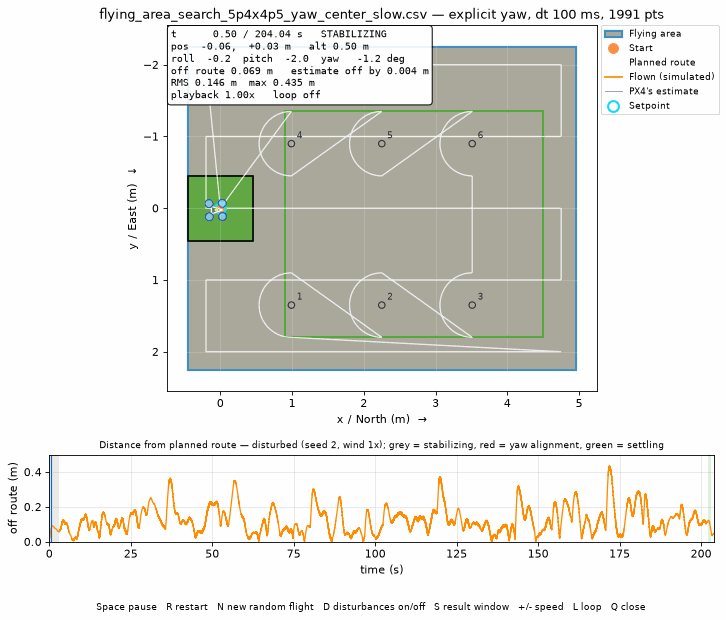
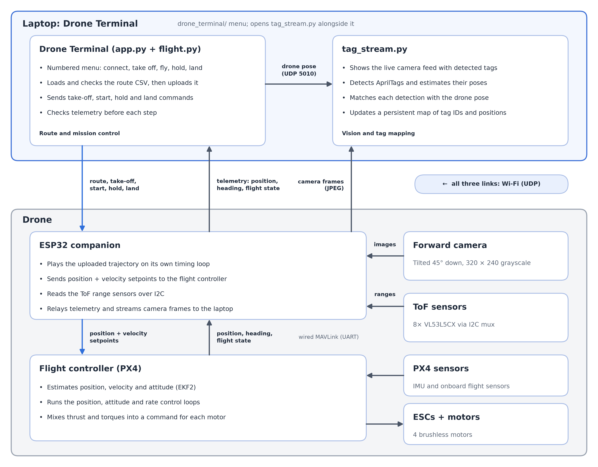
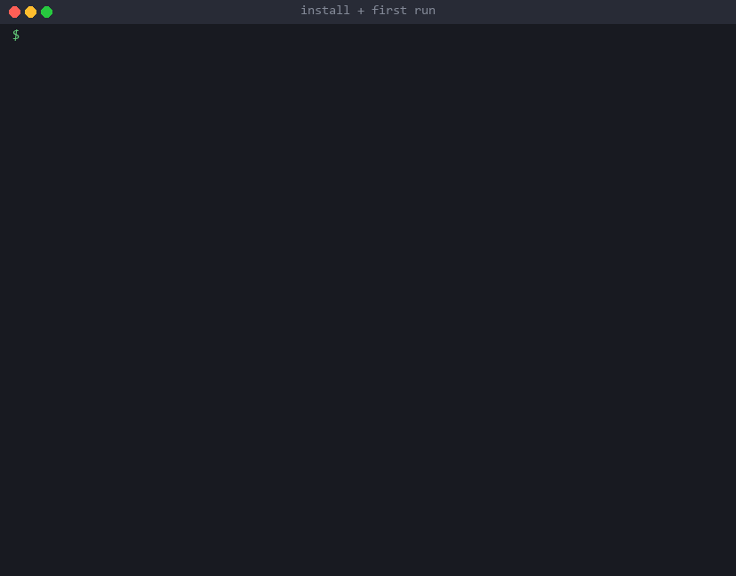
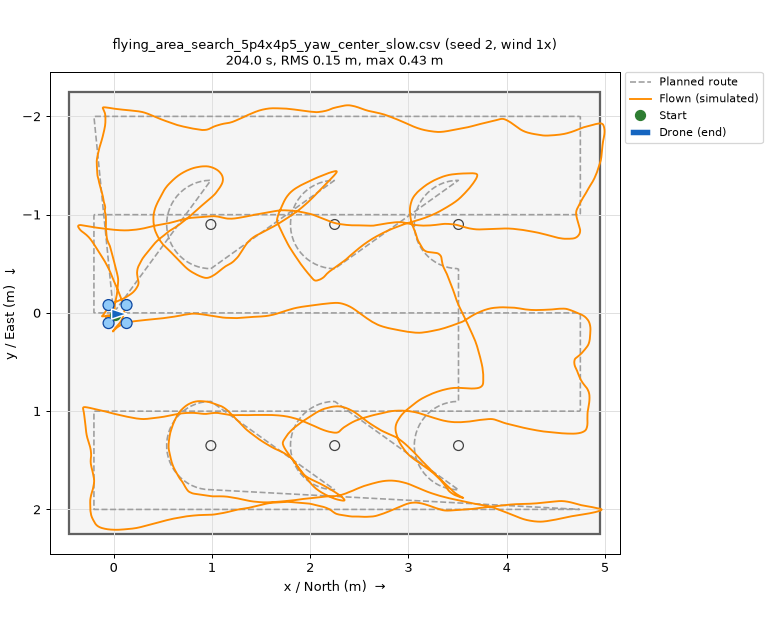
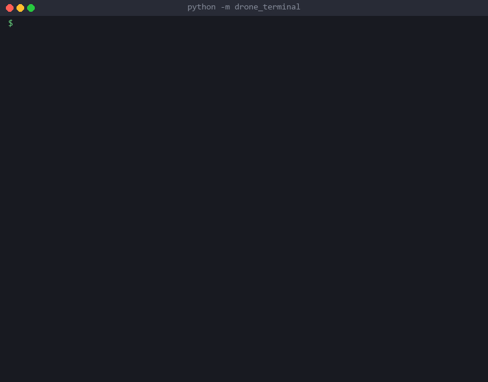

# Drone Terminal

A numbered terminal app for flying the CDE1302 ESP32 + PX4 drone, plus a
trajectory simulator that runs the drone's **real navigation firmware** on your
laptop, so routes can be tested without the drone.



*A simulated flight of `flying_area_search_5p4x4p5_yaw_center_slow.csv`. Every
decision on the ESP32 side comes from the firmware's own C code.*

---

## Contents

1. [What's in here](#1-whats-in-here)
2. [Requirements](#2-requirements)
3. [Installation](#3-installation)
4. [Quick start: simulate a route (no drone)](#4-quick-start-simulate-a-route-no-drone)
5. [Flying the real drone](#5-flying-the-real-drone)
6. [Trajectory files](#6-trajectory-files)
7. [The simulator in detail](#7-the-simulator-in-detail)
8. [Folder layout](#8-folder-layout)
9. [Troubleshooting](#9-troubleshooting)
10. [Regenerating the images in this README](#10-regenerating-the-images-in-this-readme)

---

## 1. What's in here

| Part | What it does |
|---|---|
| **Drone Terminal** (`python -m drone_terminal`) | A menu for the real drone: connect, pick a trajectory, take off, fly, GOTO, HOLD, LAND, open the camera and tag map, and watch live telemetry. |
| **Trajectory simulator** (menu option 12, or `python -m drone_terminal.trajectory_sim`) | Flies a trajectory CSV with a simulated drone. The ESP32 side is the real firmware (`main/nav_task.c`), compiled for the laptop. The drone follows the course quadrotor model (Lecture 4) and a PX4-style controller (Lecture 5). |
| **Route generator** (`generate_flying_area_search.py`) | Builds the 5.4 × 4.5 m flying-area search route as a trajectory CSV. |

How the pieces fit together on a real flight:



---

## 2. Requirements

| Need | Why | How to get it |
|---|---|---|
| **Python 3.10+** | Runs the terminal and simulator. | [python.org](https://www.python.org/downloads/) |
| **Python packages** | numpy, matplotlib, PyYAML, OpenCV, SciPy, pyserial. | `drone_terminal/requirements.txt` (see below) |
| **A C compiler** | The simulator compiles the drone's firmware for your laptop the first time it runs, and again after any firmware change. | **Windows:** MinGW-w64 `gcc`, e.g. `conda install -c conda-forge gcc` or [WinLibs](https://winlibs.com/). **macOS:** `xcode-select --install`. **Linux:** `sudo apt install build-essential`. |
| **Drone WiFi** (real flights only) | The terminal talks to the ESP32 over UDP. | Join the drone network; see the root [README](../README.md). |

You do **not** need ESP-IDF to use the terminal or the simulator. It's only
needed to rebuild and flash the ESP32 itself.

---

## 3. Installation

From the repository root:

```bash
python -m venv .venv
```

Activate the virtual environment. Windows (PowerShell):

```powershell
.venv\Scripts\Activate.ps1
```

macOS / Linux:

```bash
source .venv/bin/activate
```

Install the Python packages:

```bash
python -m pip install -r drone_terminal/requirements.txt
```

Check that a C compiler is on your PATH:

```bash
gcc --version
```

On macOS / Linux, `cc --version` also works. To use a different compiler,
set the `CC` environment variable.

Then run the simulator once. The first run compiles the firmware, which takes
a few seconds:

```bash
python -m drone_terminal.trajectory_sim trajectory/flying_area_search_5p4x4p5_yaw_center_slow.csv
```



*A real session: checking gcc and Python, installing the requirements (already
present here), then the first simulator run compiling `main/nav_task.c` and
printing the firmware's own log lines. Paths are shortened to `<repo>`.*

---

## 4. Quick start: simulate a route (no drone)

Either pick a route in the terminal and choose **12**, or run the simulator directly:

```bash
python -m drone_terminal.trajectory_sim                 # choose from trajectory/
python -m drone_terminal.trajectory_sim trajectory/flying_area_search_5p4x4p5_circles_239s.csv
python -m drone_terminal.trajectory_sim --speed 8       # play 8x faster
python -m drone_terminal.trajectory_sim --ideal         # no disturbances
python -m drone_terminal.trajectory_sim --wind 2 --seed 7   # rougher air, a repeatable flight
```

| Option | Meaning |
|---|---|
| `--speed` | Playback speed, 0.1 to 32 (1 = real time). |
| `--wind` | Disturbance strength: 0 = ideal, 1 = typical indoor (default), 2 = rough. |
| `--ideal` | Same as `--wind 0`. |
| `--seed` | Random seed. The same seed gives exactly the same flight. |
| `--start-heading` | Drone heading at take-off, in degrees (0 = North). |
| `--loop` | Restart automatically at the end. |

**Keys in the simulator window:**

| Key | Action |
|---|---|
| `Space` | Pause / resume |
| `R` | Restart the same flight |
| `N` | New random flight (next seed) |
| `D` | Disturbances on / off |
| `S` | Open the result window now |
| `+` / `-` | Faster / slower playback |
| `L` | Loop on / off |
| `Q` | Close |

**Reading the window:**

| On screen | Meaning |
|---|---|
| White line | The planned route |
| Orange line | Where the simulated drone actually flew |
| Purple line | Where PX4 *thinks* it flew (its optical-flow estimate) |
| Cyan circle | The setpoint the firmware is currently sending |
| Yellow line from the drone | Which way, and how hard, the drone is tilting |
| Drone colour | Grey = settling after take-off, red = turning to the first heading (yaw routes), blue = flying the route, green = settling on the end point |
| Bottom strip | Distance from the planned route over time |

When the flight ends, a **result window** opens with just the route, the flown
path and the drone. Save it with the window's save button.



The console prints the firmware's log and a summary line:

```text
[firmware] I 3.00 [nav] Explicit-yaw trajectory start: 1991 pts @ 100 ms from odom (0.03, -0.22, -0.50)
[firmware] I 3.05 [nav] Trajectory yaw aligned — playback clock started
[firmware] I 202.05 [nav] Trajectory done — holding last point
[sim] disturbed (seed 1, wind 1x): RMS 0.280 m, max 0.597 m, end 0.175 m, total 204.0 s  (firmware build libfwhost-AMD64-34f0daaa4487.dll)
```

---

## 5. Flying the real drone

Run from the repository root, connected to the drone's WiFi:

```bash
python -m drone_terminal
```

Enter the drone ID and press Enter to accept the default IP
(`192.168.1.<200 + ID>`). Then use the menu:



*A real session without a drone: selecting a route, checking STATUS and
opening the simulator.*

| # | Option | What it does |
|---|---|---|
| 1 | CONNECT | Starts listening for the drone's telemetry on UDP 5005. The header changes from LISTENING to CONNECTED once packets arrive. |
| 2 | SELECT TRAJECTORY | Lists the CSVs in `trajectory/`, then loads and checks your choice. It prints the point count, duration, time step and peak speed. |
| 3 | TAKEOFF AND HOLD | Takes off to 0.5 m and holds. You must type `TAKEOFF-<id>` to confirm. |
| 4 | FLY SELECTED TRAJECTORY | Asks whether to take off first and whether to LAND or HOLD at the end. You must type `TRAJ-<id>` to confirm. It then uploads the whole route; the ESP32 plays it on its own 20 Hz clock. |
| 5 | GOTO COMMAND | Flies to a map point (N, E), optionally with a fixed heading. |
| 6 | HOLD | Stops any active operation and holds position. |
| 7 | LAND | Stops any active operation and lands. |
| 8 | OPEN TAG CAMERA + PERMANENT MAP | Opens `laptop/tag_stream.py`: the live camera with AprilTag detections, plus a map of tag positions. The terminal forwards its telemetry to it on UDP 5010. |
| 9 | OPEN TELEMETRY LOG TERMINAL | Opens a second console with the live telemetry stream (UDP 5011). It also opens automatically when a take-off or flight starts. |
| 10 | STATUS | Shows the connection, the active operation, the selected route and the latest telemetry. |
| 11 | DISCONNECT | Stops listening (only when no operation is active). |
| 12 | SIMULATE SELECTED TRAJECTORY | Opens the simulator for the selected route (see section 4). |
| 0 | EXIT | Requests HOLD if anything is still active, then quits. |

**A typical flight:**
1. Simulate the route first (2, then 12).
2. **1 CONNECT**, and wait for `CONNECTED` in the header.
3. **8** to open the camera and tag map (optional).
4. **4 FLY**: take off first, choose the finish action, then confirm.
5. Keep **6 HOLD** / **7 LAND** in mind. They interrupt the flight immediately, and nothing queued afterwards is sent.

> **Safety:** Drone Terminal owns UDP port 5005, so don't run another mission
> script or telemetry listener at the same time. HOLD and LAND are always
> available while a flight runs. Keep the RC transmitter ready as the final
> fallback.

---

## 6. Trajectory files

Trajectories live in `trajectory/` as CSV files:

```text
t,x,y,z                 # time (s), North (m), East (m), Down (m)
0,0,0,0
0.10,0.0012,0.0003,0
...
```

- **Positions are offsets** from where the drone is hovering when the route
  starts. x is PX4 North, y is PX4 East, and z points down, so a constant z
  means no climb.
- An optional **fifth column `yaw_deg`** sets the heading at each point
  (0 = North, clockwise positive). The drone first turns on the spot to the
  first heading, then the route starts. Yaw routes are refused if they need
  more than 45°/s of turning rate or 90°/s² of angular acceleration.
- A route can have at most **2,400 points**, the ESP32's limit. Longer files
  are automatically resampled at a coarser time step.

The 5.4 × 4.5 m flying-area search route is generated by:

```bash
python drone_terminal/generate_flying_area_search.py
```

This writes `trajectory/flying_area_search_5p4x4p5_under200s.csv`: a five-lane
sweep, then half-circles around the six possible tag locations, in under 200 s.

---

## 7. The simulator in detail

### The ESP32 side is the real firmware

`firmware_host.py` compiles the firmware's own files (`main/nav_task.c`,
`main/vfh.c` and `main/odom.c`) **unchanged** into a small library, together
with `fw_host/fw_host.c`. That file stands in for the parts of the drone the
firmware talks to:

| On the drone | In the simulator |
|---|---|
| FreeRTOS timing | The simulator's clock. The firmware's own `nav_task()` loop runs on a thread in lockstep with the simulation, at its real 20 Hz rate. |
| `mavlink_task` (to PX4) | Setpoint functions copied from `mavlink_task.c`, including its speed clamp. The setpoints are flown by the simulated PX4. |
| ToF sensors | None (`TOF_ENABLED` is 0 on the drone too). |
| WiFi | Always connected, no other drones. |
| `ESP_LOGx` log lines | Printed to the console as `[firmware] ...`. |

The simulator uploads the route and sends START exactly as Drone Terminal does.
Everything after that is decided by the firmware: whether to accept the route,
heading alignment, playback and holding the end point.

**Editing the firmware changes the simulation.** The library is cached under a
hash of its sources in `drone_terminal/.fw-host/`. Any change to those `.c`
files, or to any header in `main/`, triggers an automatic rebuild on the next
run. For example, removing the velocity feed-forward from `nav_task.c` raises
the simulated tracking error from 0.03 m to 0.13 m.

### The drone and PX4

The drone is the CDE1302 Lecture 4 quadrotor model, with the course's
identified parameters (0.302 kg, inertia, propeller coefficients, motor curve,
0.02 s motor time constant):
- first-order motor dynamics;
- X4 force and moment allocation;
- 6-DOF rigid-body dynamics with Euler-angle kinematics.

It is flown by the Lecture 5 / PX4 control chain:
1. position control, with the firmware's velocity feed-forward;
2. velocity control;
3. conversion to a tilt-limited thrust and attitude;
4. attitude control;
5. angular-rate control;
6. control allocation to the four motors.

### Disturbances

| Factor | Effect |
|---|---|
| Turbulence | Random gusts push the drone around. |
| Steady draft | A constant push from one direction (e.g. air conditioning). |
| Motor vibration | Small, rapid jitter. |
| Drag | Resistance that increases with speed. |
| Position estimate error | The optical-flow estimate drifts, so PX4 corrects toward where it *thinks* the drone is. |
| Attitude disturbances | Small random roll, pitch and yaw torques. |
| Communication timing | Setpoints every 0.05 s, arriving after a short delay. |

The flying area is drawn for reference only. There are no walls, so the drone
can fly past its edges.

### Limitations

- Disturbance levels, drag and PX4 gains are **typical values, not measured
  on our drone**. Results show the kind and size of error to expect; they are
  not predictions of an exact flight.
- **Not simulated:** PX4 itself, the WiFi packet parsing (`wifi_task.c`), the
  take-off sequence (`mission_task`), or any sensors. The ToF and camera
  readings are not modelled, so sensor-driven behaviour can't be tested yet.

---

## 8. Folder layout

```text
drone_terminal/
├── __main__.py, app.py          # the menu (python -m drone_terminal)
├── flight.py                    # flight runner: upload, take-off, START, checks, landing
├── transport.py                 # UDP link to the drone (CommsNode)
├── telemetry_log.py             # live telemetry console (menu option 9)
├── trajectory_sim.py            # the simulator window and drone model
├── firmware_host.py             # compiles + runs main/nav_task.c on the laptop
├── fw_host/                     # stand-ins for FreeRTOS, MAVLink, ToF, WiFi
│   ├── fw_host.c
│   └── include/
├── generate_flying_area_search.py
├── requirements.txt
└── docs/                        # README images and the script that makes them
```

The terminal also uses `laptop/protocol.py` (packet formats) and
`laptop/tag_stream.py` (camera and tag map).

---

## 9. Troubleshooting

| Problem | Fix |
|---|---|
| `no C compiler ('gcc' not on PATH)` | Install a compiler (section 2), or set `CC` to one. The build uses gcc-style flags, so Visual Studio's `cl.exe` won't work. |
| `firmware build failed` | The compiler output is printed. Usually a syntax error in a firmware file you just edited. |
| `the firmware refused START` | The firmware rejected the route. Its log line above says why (e.g. yaw rate too high). |
| Header stays `LISTENING` after CONNECT | No telemetry from that drone. Check the drone ID/IP, the WiFi network, and that nothing else is using UDP 5005. |
| CONNECT fails with an address/port-in-use error | Another script is listening on UDP 5005. Close it. |
| Route takes longer than expected to load | Files over 2,400 points are resampled. The terminal prints a note when this happens. |

---

## 10. Regenerating the images in this README

```bash
python drone_terminal/docs/make_readme_media.py
```

The terminal GIFs replay real sessions saved in `docs/recordings/`, with
paths shortened to `<repo>`. The simulator GIF and result image come from an
actual simulated flight. The system diagram is made by
`report_assets/make_architecture_diagram.py`.
